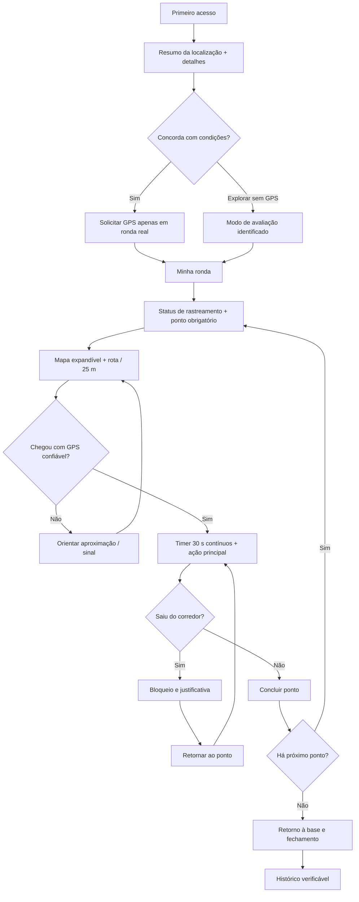
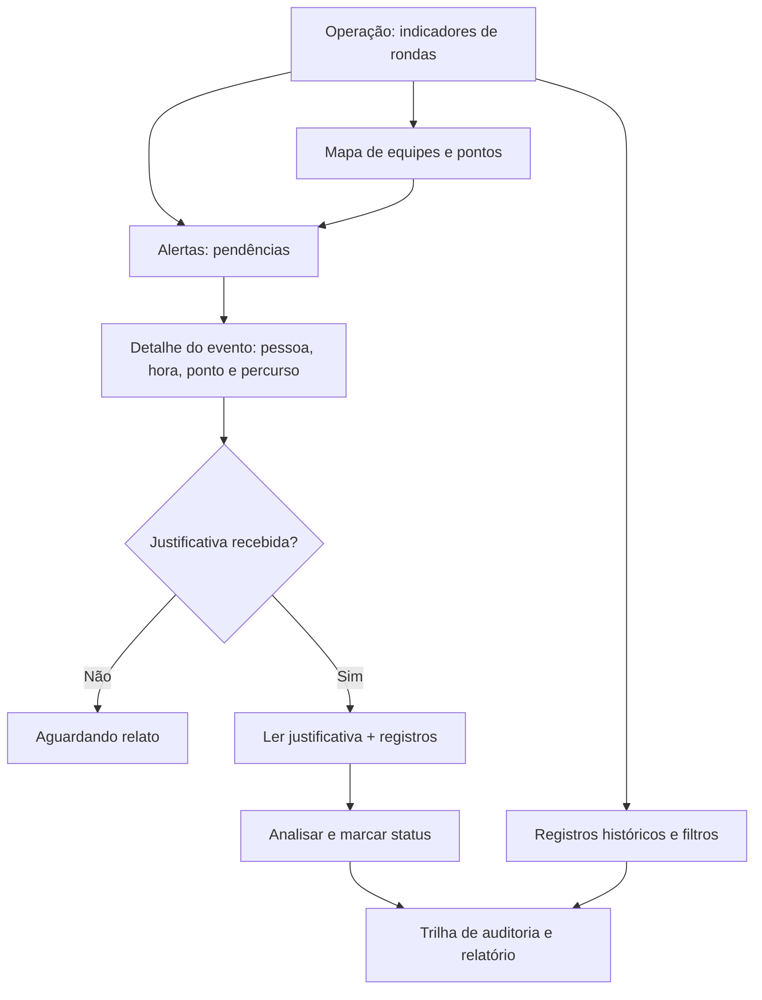

# Etapa 02 · Auditoria mobile-first e arquitetura dos fluxos | Hondas Maxvel

**Data:** 11/10/2026 · **Status:** diagnóstico e proposta de arquitetura concluídos; redesign visual ainda não implementado.  
**Projeto:** `danielnep/app-hondas-maxvel` · **Origem examinada:** código de `main` com mudanças de instrumentação de teste, sem mudanças de regra de negócio.  
**Diretriz:** interface operacional premium, adulta e mobile-first, preservando identidade Horizon. Sem gamificação.

## 1. Como auditamos

A auditoria combina análise estática do HTML/CSS/JS e dois percursos automatizados em Chromium de verdade. O primeiro passou por **320×640, 360×740, 375×812, 390×780, 412×915, 430×760 e desktop 1440×900**. O segundo completou **60 capturas em 320, 360, 390, 430, 768 e 1440 px**, incluindo onboarding, landing, escolha de perfil, ronda antes/depois de iniciar, regras, desvio, justificativa, supervisão e apresentação integrada. A simulação foi executada com dados fictícios, não com GPS real.

**Evidências auditáveis:**
- [Auditoria com seis larguras compactas, 32 capturas e resultados estruturados](https://github.com/danielnep/app-hondas-maxvel/actions/runs/38176691397) → artefato `maxvel-ux-audit-stage02`.
- [Auditoria complementar, seis layouts incluindo tablet/desktop, 60 capturas](https://github.com/danielnep/app-hondas-maxvel/actions/runs/38176825191) → artefato `maxvel-ux-mobile-stage2`.
- [Pesquisa e princípios técnicos anteriores](PESQUISA-UX-MOBILE-2026.md).

**Cuidado ao interpretar:** os testes automatizados terminaram sem falha fatal e obtiveram evidências, mas isso **não significa que a usabilidade foi aprovada**. O segundo percurso precisou acionar por código um botão **Sair** oculto, justamente para conseguir auditar a supervisão. Não houve teste com profissionais de ronda, leitores de tela físicos, diferentes aparelhos Android ou Apple, nem implantação com rastreamento real.

## 2. Achados objetivos ordenados por gravidade

### P0 · Navegação mobile vertical ocupando a tela

**Reprodução:** login como ronda em largura 320–430 px; a barra inferior mostra três destinos **empilhados verticalmente**, com aproximadamente **178 px de altura**. Na supervisão, cinco destinos ocupam aproximadamente **296 px**. Comparar capturas `390-03-ronda-before.png` e `390-09-supervisor.png`.

**Causa identificada:** a regra `.mobile-only { display:block }` no media query de até 600 px sobrepõe a intenção de layout flex de `.mobile-nav { display:flex }`. A navegação passa a empilhar itens, reduz o mapa utilizável, invade o espaço da operação e cria hierarquia imprópria.

**Correção exigida:** bottom navigation **horizontal** com alvos ≥44–48 px, rótulos curtos e três destinos para o ronda; quatro para supervisão. Para telas médias, rail/sidebar adaptativa. Medir em 320–430 px e testar área segura (`safe-area-inset-bottom`).

### P0 · Troca de perfil e saída inacessíveis no telefone

**Reprodução:** em telas compactas, clicar em **Sair** não é possível pelo fluxo visível. Nos testes, o elemento de saída estava dentro da `.sidebar`, ocultada abaixo de 900 px. O avatar mobile não possui opção de perfil/sair. As primeiras tentativas falharam; a segunda bateria de auditoria só avançou para a supervisão usando acionamento programático de elemento oculto.

**Correção exigida:** menu de perfil acessível pelo avatar com `Trocar perfil`, `Ajuda`, `Privacidade` e `Sair`. Não inserir mais um destino na bottom navigation apenas para esconder essas ações. Testar acesso manual no celular.

### P0 · CTA operacional e mapa não aparecem na primeira dobra

**Reprodução:** em 390×740, o mapa inicial da ronda começa próximo de **y=691 px**, atrás de um menu inferior que inicia em **y=562 px**. O botão **Iniciar ronda** vem depois do mapa e de várias instruções. O usuário precisa procurar e rolar antes de agir; estado, mapa e ação ficam dissociados. Na supervisão, o mapa começa por volta de **y=903 px** no fluxo documentado.

**Correção exigida:** no celular mostrar antes da dobra status GPS/ronda, ponto atual, estado da validação e **próxima ação**; mapa deve ser destaque e permitir expansão, com ações por painel compacto/dock que não encubra as ruas. Detalhes e ajuda podem expandir, nunca bloquear acesso ao essencial.

### P1 · Consentimento de localização grande demais

**Reprodução:** modal obrigatório em **320×640** com conteúdo de **1302 px**, mas área visível de **574–664 px** conforme viewport/execução; CTA aparece abaixo de **y=1100 px**, inacessível sem rolar bastante. Em **390 px** o botão também começa abaixo da primeira dobra. O cabeçalho mostra ícone de fechar `X`, mas o modo obrigatório impede sua ação.

**Correção exigida:** primeira abertura com título direto, resumo da finalidade e funcionamento em segundo plano, detalhes progressivos legíveis, checkbox e ação principal alcançáveis sem sacrificar transparência. Disponibilizar alternativa para explorar sem GPS. Não tratar ciência como permissão do Android. Remover `X` inoperante ou tornar o fechamento seguro e consistente.

### P1 · Alvos pequenos e microtipografia

**Reprodução:** a auditoria registra alvos com altura ou largura inferior a **44 CSS px** em todos os perfis (por exemplo, botão de fechar de 36×36 px e ações `.button.small` de 37 px). Há textos operacionais de 10–12 px nos cartões, botões, ajuda, mapas e KPIs; as capturas mostram dificuldade de diferenciação visual.

**Correção exigida:** toque mínimo operacional de **44–48 px**, títulos e rótulos funcionais visíveis, corpo principal preferencialmente **14–16 px**, escala de texto adaptativa, estados de foco e contraste WCAG 2.2. Não confundir o tamanho do SVG com a área de clique.

### P1 · Hierarquia e identidade excessivamente pálidas

**Reprodução:** plano de fundo `#f4f9fc`, cartões brancos, rótulos azul-pálido e acentos semelhantes, em excesso. A combinação **`#668092`/`#f4f9fc` = 3,91:1**, e **branco/`#0e90c7` = 3,60:1**: ambas aquém de 4,5:1 para texto comum. A identidade Horizon não exige uma interface permanentemente pastel.

**Correção exigida:** etapa 03 constrói tokens semânticos, considerando estrutura grafite/azul-marinho, ciano tecnológico pontual e cartões com contraste. Aplicar cores por significado (ação, ativo, atenção, desvio, concluído), sem usar apenas a cor para comunicar status. Não improvisar dark mode invertido.

### P1 · Apresentação integrada inadequada em tela compacta

**Reprodução:** em **390 px**, o topo exibe o texto comercial e controles da demonstração antes da vista efetiva de ronda e supervisor; a tela do mapa dentro da apresentação surge cerca de **y=1467 px**. A experiência empilha uma moldura de telefone dentro do próprio celular.

**Correção exigida:** no celular uma barra de contexto e seletor claro `Ronda | Supervisão` compartilham a mesma sessão; no desktop, visão simultânea lado a lado. O comprador navega pelo **produto funcional**, sem obrigatoriedade de moldura/marketing extensa antes da tarefa.

### P2 · Fragmentação do CSS e orientação excessiva

**Reprodução:** múltiplos media queries em cascata (`600`, `640`, `650`, `690`, `900`, `950`, `1150`, `1200` px), com `.mobile-only` sobrescrevendo `.mobile-nav`; coach, telemetry, route card e outras orientações repetem conteúdo e empurram o mapa e ações para baixo.

**Correção exigida:** unificar CSS por tokens, componentes e tamanhos por intenção, `min-width` progressivo; reduzir o coach a uma linha contextual expansível e evitar repetição de status. Testar todas as transições.

## 3. O que funcionou e não deve ser perdido

- Os percursos de início, simulação de desvio, bloqueio e registro de justificativa **chegaram aos estados previstos** nos navegadores de teste.
- Não observamos **overflow horizontal do documento** nas larguras testadas. Isso não exclui problemas de rolagem em componentes e modais.
- O mapa usa cartografia real quando as tiles carregam e mantém a possibilidade de fallback esquemático; a rota do exemplo é **ilustrativa**, não valida trajeto seguro nas ruas.
- A versão web não promete GPS depois de fechar o navegador; o serviço Android exige teste específico. A interface mantém distinção entre simulação, localização real e ciência inicial.
- Os testes do domínio permanecem independentes do layout. Alterações de UI devem preservar raio **25 m**, permanência **30 s contínuos**, sequência, desvio → justificativa → retorno e conclusão na base.

## 4. Wireflows propostos (etapa 03/04, não implementados)

### 4.1 Operador/ronda: navegação e ações

**Bottom nav do ronda:** `Minha ronda` · `Ocorrências` · `Histórico`. **Perfil/ajuda** no cabeçalho. CTA contextual próximo ao polegar, sem cobrir mapa, com texto que muda de acordo com o estado. A tela deve apresentar ação principal sem obrigar leitura de blocos de instruções repetidos.

### 4.2 Supervisão: triagem e decisão

**Bottom nav da supervisão:** `Operação` · `Mapa` · `Alertas` · `Registros`. Gestão e administração mantêm recursos adicionais em menu secundário. Um evento exige descrição, evidência e revisão humana; **GPS impreciso não é prova disciplinar automática**.

### 4.3 Responsividade por intenção

| Faixa / contexto | Arquitetura prevista |
|---|---|
| Compacto 320–430 px | barra inferior horizontal; uma coluna; cabeçalho compacto; status + CTA; mapa expandível; formulários sem dupla rolagem concorrente |
| Médio/tablet 768 px | navegação lateral/rail quando couber; mapa dominante + detalhe refluindo, sem esconder troca de perfil |
| Desktop 1440 px | sidebar persistente; mapa de operação com fila de alertas à direita, KPIs densos e histórico embaixo |
| Apresentação comercial | mesmas funções reais; no celular troca de perspectiva; no desktop ronda e supervisão paralelos |

## 5. Requisitos objetivos para a próxima implementação

- [ ] 320, 360, 375, 390, 412 e 430 px: nav ≤72 px mais safe area, **horizontal** e legível, sem rolagem lateral.
- [ ] Troca de perfil e sair acionáveis no celular com clique real, sem script que execute botão oculto.
- [ ] CTA de início/conclusão/justificativa visível ou alcançável pela interface sem rolagem excessiva; teclado aberto não deve esconder enviar.
- [ ] Consentimento claro com alternativa sem GPS, sem X inoperante; detalhes permanecem acessíveis.
- [ ] Identificação contínua do status GPS, ponto atual, raio e tempo. Erro/sinal incerto tem orientação e recuperação.
- [ ] Mapa legível, controles sem conflito com dock, legenda de rota planejada, realizada, base e área de 25 m.
- [ ] Revisão de cada par de tokens de texto ≥4,5:1 em texto normal; controles significativos ≥3:1. Botões operacionais ≥44–48 px.
- [ ] Ronda, justificação, retorno, supervisão, alertas e histórico testados a partir da interface com capturas.
- [ ] Regressão de domínio e serviço Android nativo isolados: nada de prometer monitoramento após parada forçada.
- [ ] Sem gamificação; preservação Horizon com personalidade adulta, sóbria, tecnológica e contrastada.

## 6. Próxima etapa explicitamente separada

**Etapa 03: sistema visual e biblioteca de componentes.** Criar tokens claros/escuros, tipografia, botões, navegação, formulários, status, mapas e critérios de acessibilidade. **A etapa 02 não aplica redesign de produção:** produzir guia validável e só depois codificar. A alteração do layout será iniciada na etapa 04, após revisão do sistema visual.

**Critério para considerar esta auditoria concluída:** evidências de telas reais, problemas identificados e priorizados, wireflows por perfil, especificação responsive e critérios de aceite disponíveis no repositório. **Não declarar aplicativo aprovado ou redesenhado com base nos testes de auditoria.**